# Trading Funnels

Trading Funnels is a research-only analytics surface for certified
`TVDonchianCciHierarchyStrategyV5` exports. It is integrated into the existing journal at:

```text
http://localhost:3000/analytics/trading-funnels
```

It does not place orders, alter NinjaTrader, or merge V5 parent trades into the journal's SQLite
execution ledger.

## Start the journal with the imported analytics store

The V5 CLI scripts run from the repository root, while the filtered web package runs with
`apps/web` as its process directory. Set `JOURNAL_DATA_DIR` explicitly so both processes open the
same DuckDB file:

```powershell
$env:JOURNAL_DATA_DIR = (Resolve-Path .\data).Path
pnpm dev
```

Open the URL printed by Next.js, then go to **Analytics → Trading funnels**. The usual URL is:

```text
http://localhost:3000/analytics/trading-funnels
```

If port 3000 is already occupied, Next.js prints the alternate port it selected. Do not run the
CLI importer or validator against the same writable DuckDB file while the journal is running; use
the in-app importer instead, or stop the journal first.

## Validated data currently available

The repository's current analytical store contains this certified source snapshot:

| Field                    | Value                                                                                |
| ------------------------ | ------------------------------------------------------------------------------------ |
| Run                      | `711667acaeae4bdeb78dda1aa41f445e`                                                   |
| Strategy                 | TV Donchian CCI Hierarchy Strategy V5 `5.3.0`                                        |
| Instrument               | EURUSD                                                                               |
| Collection               | Playback, realtime-forward                                                           |
| Source status            | OPEN at checkpoint `163196`                                                          |
| Source timezone          | `America/Toronto`                                                                    |
| Completed M15 bars       | 163,196                                                                              |
| Event rows               | 1,290,159 certified by the manifest; the committed prefix ends at byte 1,688,222,852 |
| Opportunities            | 5,129                                                                                |
| Parent-outcome revisions | 92,602                                                                               |
| Executed parent trades   | 5,129                                                                                |
| Trade-time coverage      | 2020-01-15 03:00 ET through 2026-09-16 11:07 ET                                      |

Because this source run is OPEN, the importer reads only the byte ranges, row counts and hashes
certified by `manifest.json`. It ignores any later, uncertified CSV tail.

The current snapshot passes `pnpm analytics:validate 711667acaeae4bdeb78dda1aa41f445e`.
The validation reconciles the run totals, stage drop-offs, signal-time and completed-entry-bar HH7
categories, close-confirmation categories, frozen entry-feature cardinality, both requested combined
cohorts, follow-through population retention, and a trade chart's candle/fill alignment.

## UI walkthrough and sample states

[Open the full Figma-style UI board](trading-funnels-ui-board.html). It groups 17 real captures from
the running app into the ingest, research funnel, parent evidence, playback dashboard and Reports
flows.

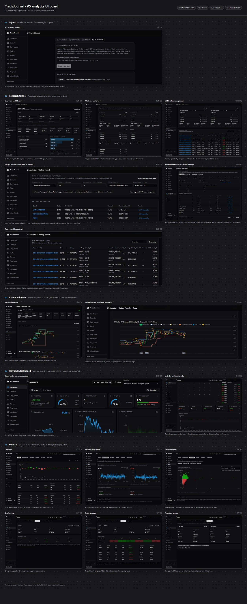

### Sample flow: import and run registry

1. Open **Import → V5 analytics**.
2. Enter `C:\temp\711667acaeae4bdeb78dda1aa41f445e`.
3. Choose **Import analytics**.
4. Confirm the imported-run card shows EURUSD, checkpoint `163196` and status `OPEN`.

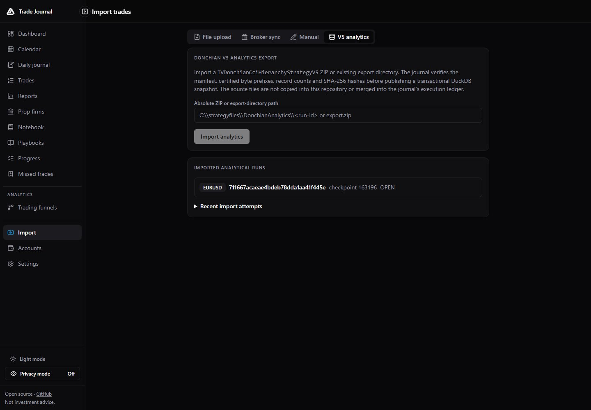

### Sample flow: funnel overview and filters

Open **Analytics → Trading funnels** and select the imported run. The first viewport shows the
shared filters, KPI strip, signal-to-execution funnel and executed-parent target funnel.

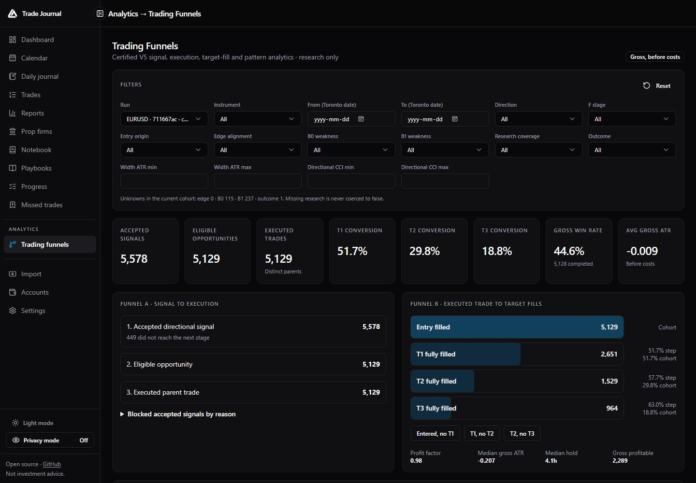

Useful interactions to try:

- choose **T3 fully filled** to focus the exact 964 contributing parents;
- choose **Entered, no T1** to focus the 2,478 first-stage drop-offs;
- filter by direction, F stage, entry origin, edge, B0/B1, outcome, width or directional CCI;
- expand **Blocked accepted signals by reason** to inspect event diagnostics.

### Sample flow: reusable attribute cohorts

Choose **HH7 direction at entry signal** in the attribute explorer. Each category is its own
conversion funnel with sample size, target completion, gross win rate, ATR outcomes and
missing/invalid counts.

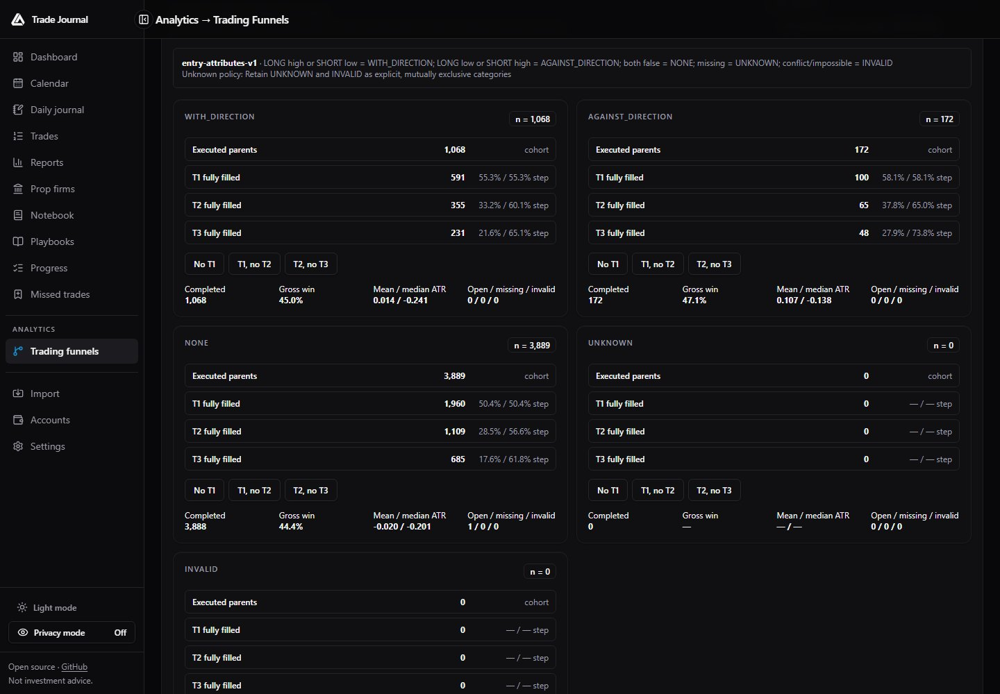

Switch the attribute selector to inspect F stage, entry origin, direction, Donchian width,
directional CCI, edge alignment, inside-day status, B0/B1 weakness, second-thrust failure, research
coverage or outcome without changing the funnel implementation.

### Sample flow: compare two AND cohorts

The default comparison is HH7 present versus HH7 absent. Add up to eight AND conditions on either
side, then select a stage to send the exact matching IDs to the parent table.

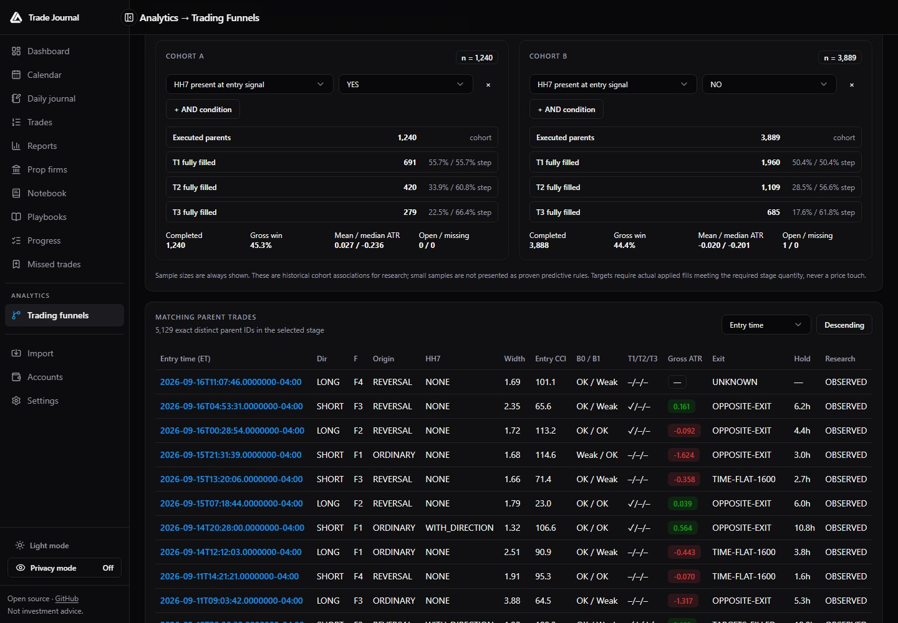

Example comparison:

- Cohort A: `F stage = F2` AND `HH7 direction = AGAINST_DIRECTION`;
- Cohort B: `F stage = F2` AND `HH7 direction = NONE`;
- select **T3 fully filled** on each side to compare the exact parents that completed all targets.

### Sample flow: entry confirmation and follow-through

Use **Entry Confirmation & Follow-Through** to inspect completed entry-candle evidence separately
from signal-time features. Select either the penetration-adjusted trigger or the original frozen
Donchian band as the breakout reference, set directional CCI/ROC thresholds, and choose an
additional registry-backed branch. Every mutually exclusive branch shows its parent count,
T1/T2/T3 conversion, gross win rate, mean/median gross ATR and expandable exact parent IDs.

**Load requested HH7 + close comparison** configures the two existing AND-cohort cards as:

- Cohort A: no HH7 on the completed entry bar AND close not beyond the selected reference;
- Cohort B: direction-aligned HH7 on the completed entry bar AND close beyond the selected
  reference.

Branch order is an analytical grouping choice. HH7, close, CCI, ROC, width and context values on
the same completed entry candle are not presented as a chronological sequence.

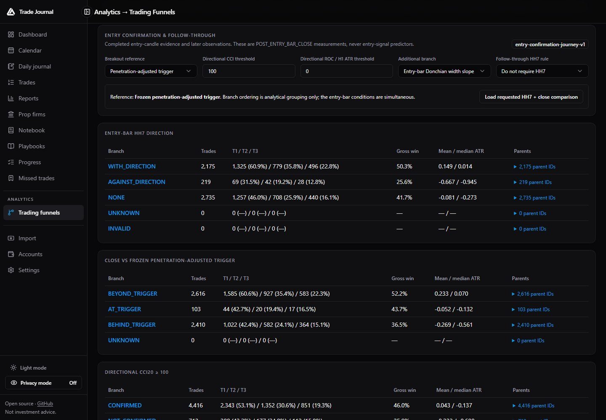

After choosing a branch or combined cohort, the follow-through section evaluates B1, B2, B3 and B5,
reports retained/regained breakout state, directional HH7, CCI/ROC recovery and subsequent momentum
failure, and separates retrospective target fills from fills completed strictly after the selected
TRADE observation became available.

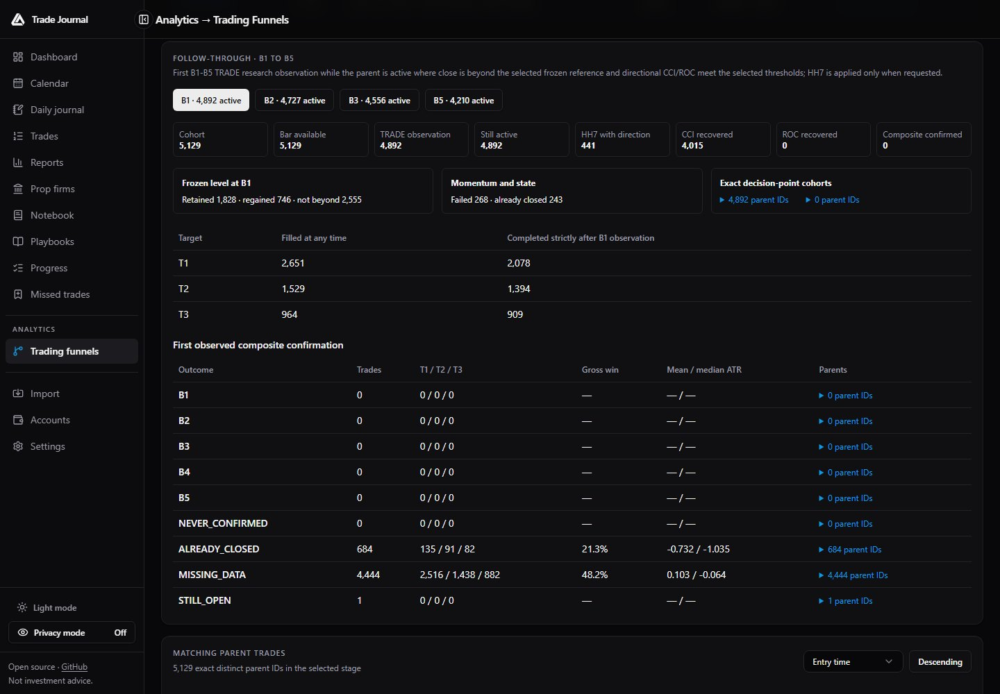

### Sample flow: inspect exact parent IDs

The table keeps the active global filters, selected stage, attribute category and cohort focus. Sort
by entry time, gross ATR, duration, width or entry CCI, then open any linked entry time.

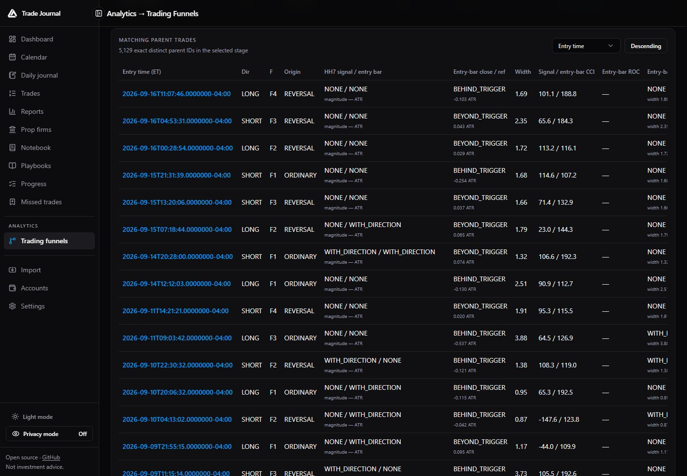

### Sample flow: trace one parent to certified evidence

Open parent `711667acaeae4bdeb78dda1aa41f445e-T2`. The first frame shows the frozen entry context and the
execution-price chart. The second frame shows Donchian/HH7/F-stage context, CCI and the fill ledger.

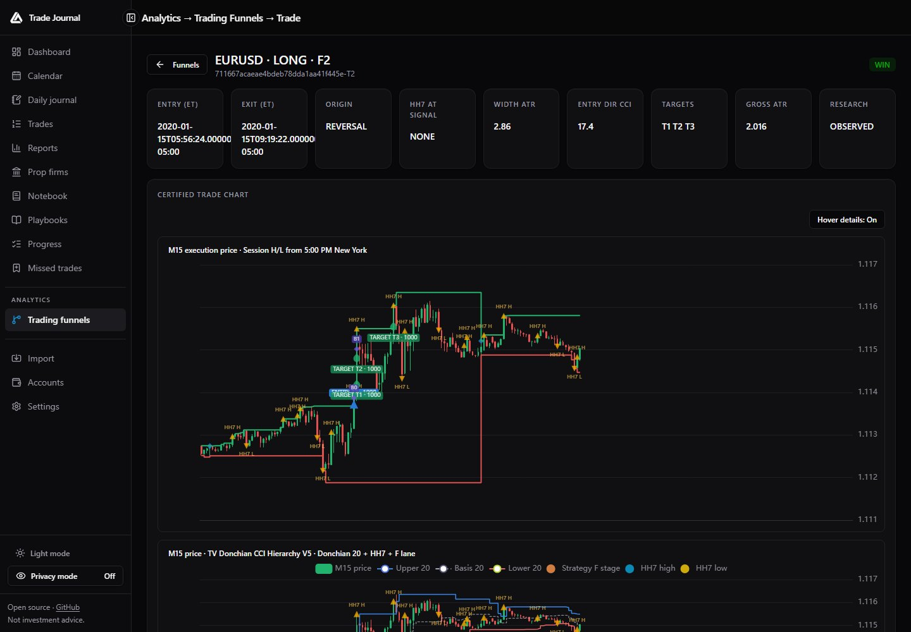

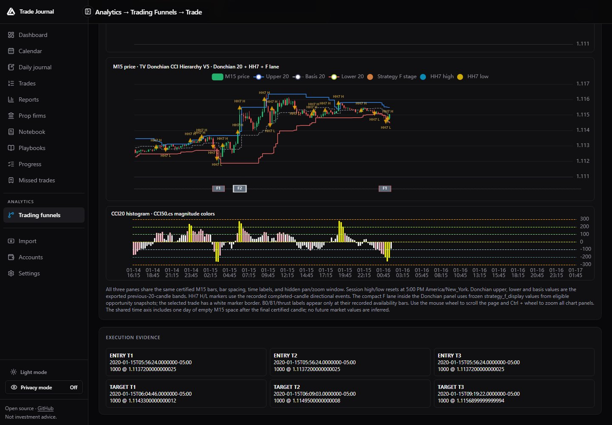

Use **Hover details** for exact bar values and Ctrl + wheel to zoom all synchronized chart panels.
The Hover details setting is stored in the browser, survives page reloads and new same-origin
windows, and synchronizes between open tabs/windows. The shared crosshair shows its datetime label
only on the lowest CCI panel; the two upper panels retain their price crosshair labels without
repeating the datetime. Upper-panel detail popups likewise omit the shared datetime heading.
The **Funnels** button preserves the previous research context when returning.

### Sample flow: use V5 parents on the Dashboard

On the Dashboard, change **Population** to **V5 Playback · EURUSD · checkpoint 163196**. The normal
cards relabel themselves for parent/gross semantics while staying read-only.

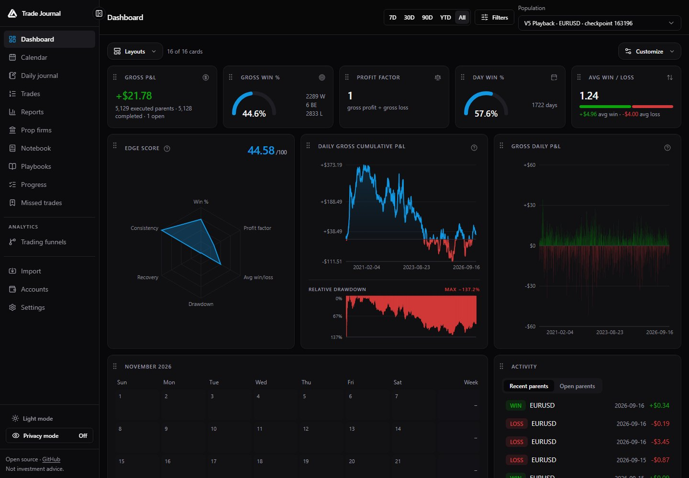

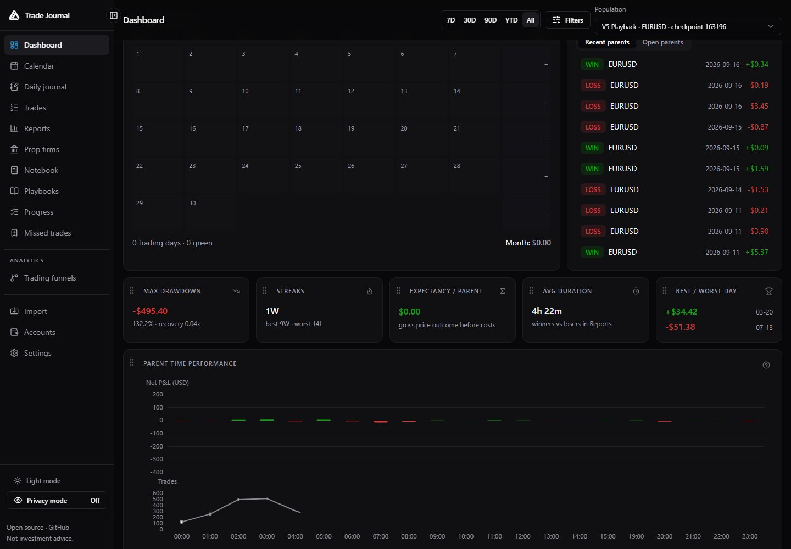

This view is useful for gross P&L, win rate, Edge Score, equity, daily results, recent/open parents,
drawdown, streaks, expectancy, duration and opening-hour performance.

### Sample flow: explore all seven Reports modes

On Reports, select the same V5 playback population and switch among the seven modes.

**Overview** — time performance plus the core gross-P&L breakdowns and PDF/PNG export.

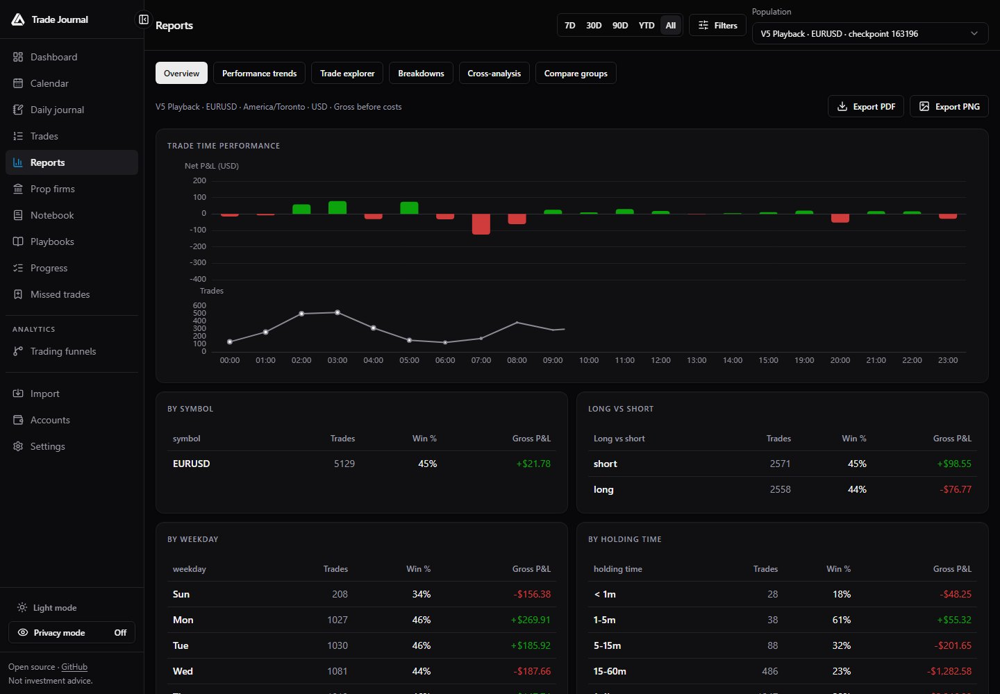

**Session calendar** — move backward or forward by month, select a populated closing-session day,
then inspect every parent that completed in that session. All of the session's parents are plotted
together in the certified candle view at the bottom; use **Plot alone** to isolate one parent, or
select its ID to open full detail. Journal populations use the same calendar and session list, with
links to ordinary trade detail. For playback parents, the **Scale-out** column is derived from the
certified target fills and shows the attained T1/T2/T3 stages, including partial target fills.

**Performance trends** — rolling 20-parent win rate and average gross P&L, plus the largest winner
and loser.

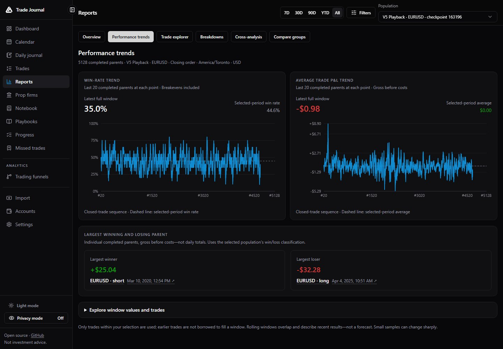

**Trade explorer** — one point per completed parent, with selectable duration and gross-P&L axes.

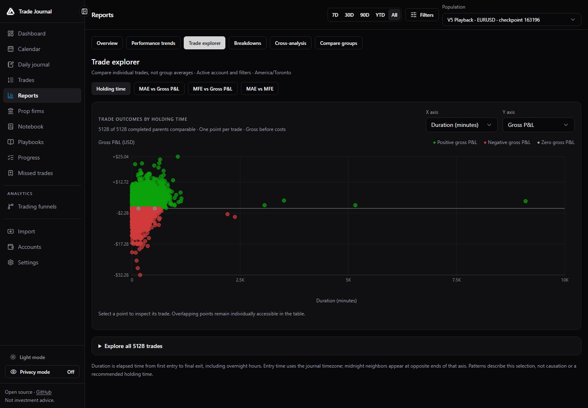

**Breakdowns** — choose one supported dimension and export the exact group table.

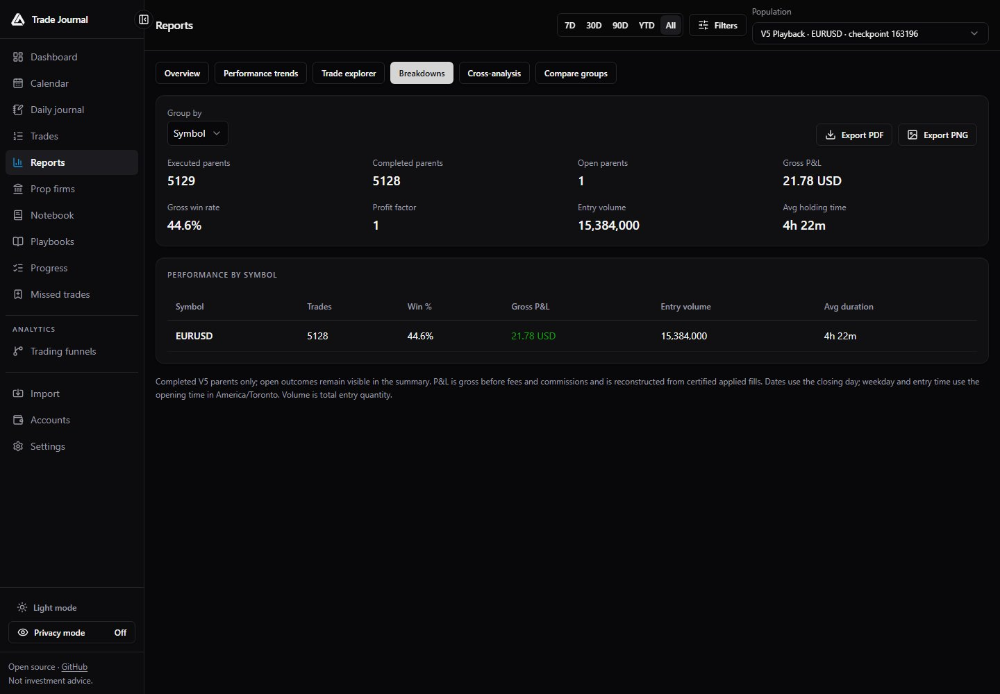

**Cross-analysis** — choose two dimensions for a gross-P&L matrix and its supporting rows.

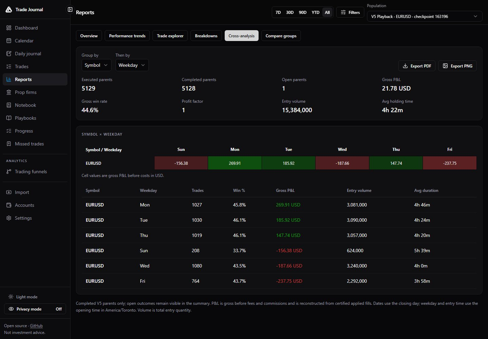

**Compare groups** — give each side independent filters and compare the resulting parent counts and
gross P&L directly.

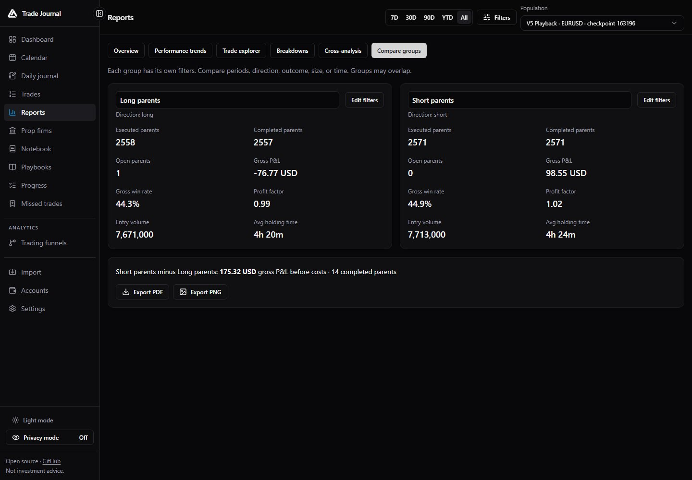

## Importing a V5 export

1. Start the journal with `pnpm dev` (or `pnpm preview`).
2. Open **Import → V5 analytics**.
3. Enter the absolute path to either the V5 export directory or its ZIP archive.
4. Choose **Import analytics** and wait for validation and transaction publication to finish.
5. Open **Analytics → Trading funnels**.

The equivalent CLI is:

```powershell
pnpm analytics:import 'C:\strategyfiles\DonchianAnalytics\<run-id>'
pnpm analytics:validate <run-id>
```

Stop the journal before using the CLI unless `JOURNAL_DATA_DIR` points to a different store;
DuckDB permits multiple connections in one journal process but intentionally does not allow two
processes to open this writable analytics file. Use the in-app importer while the journal is
running.

Do not copy the ZIP or raw CSV streams into Git. The source remains in its original location. ZIP
members are streamed to a temporary OS directory and removed after import.

## Certification and reimports

The importer treats `manifest.json` as authoritative. It explicitly supports bundle schema
`donchian_analytics_4.1.0`, feature schema `donchian_b0_4.0.0`, event schema
`donchian_events_1.4.0`, and native outcome schema
`donchian_producer_parent_outcomes_1.0.0`.

Before opening a DuckDB transaction, every stream is checked for:

- its certified byte boundary;
- rolling SHA-256 prefix hash;
- certified record count;
- required version and run identity fields.

For OPEN exports, an exact temporary copy is made only when a source file has an uncertified tail.
DuckDB therefore cannot read past the manifest certificate. Reimporting the same run/checkpoint/hash
is a no-op. A later checkpoint replaces that run atomically. An older checkpoint or a conflicting
manifest at the same checkpoint is rejected.

## Analytical store

The canonical store is `trading-funnels.duckdb` under `JOURNAL_DATA_DIR` (the same local data
directory used by the journal). It is excluded from Git by the existing `data/` ignore rules.

| Table                | Grain                                                                  |
| -------------------- | ---------------------------------------------------------------------- |
| `analytics_runs`     | One imported run/checkpoint snapshot                                   |
| `signals`            | One accepted directional signal event                                  |
| `opportunities`      | One eligible `(run_id, opportunity_id)` snapshot                       |
| `trades`             | Latest certified revision per executed `(run_id, parent_trade_id)`     |
| `trade_fills`        | One admitted nonduplicate applied execution identity                   |
| `trade_milestones`   | One parent with entry/T1/T2/T3 completion flags                        |
| `attribute_registry` | Reusable attribute definitions, phase, rule, unknown policy, version   |
| `entry_features`     | One categorized feature row per executed parent and frozen opportunity |
| `trade_research`     | One TRADE measurement per parent and completed bar                     |
| `regime_research`    | One REGIME measurement per measurement identity and bar                |
| `bars`               | One certified completed M15 candle                                     |

Imports are serialized through one writer. Readers use separate DuckDB connections and see only
committed snapshots. Failed imports roll back without replacing the previous checkpoint. Import
attempts and errors are visible on the V5 analytics import tab.

Gross price and ATR outcomes use admitted applied entry and closing execution quantities/prices.
They are labelled **gross, before costs**. Open, unreconciled, or ATR-incomplete parents stay out of
completed-trade profitability denominators.

## Current data features

### Certified source import and run management

- Import either an absolute export-directory path or a ZIP archive from **Import → V5 analytics**.
- Validate the manifest schema, stream identity, certified byte boundary, SHA-256 prefix, row count
  and run ID before opening the publication transaction.
- Accept the current certified V5 bundle, feature, event and parent-outcome schema versions only.
- Record the run, checkpoint, manifest hash, import time, validation status and recent import
  attempts, including failures.
- Treat an identical run/checkpoint/hash as an unchanged no-op, except when a prior analytics-store
  schema lacks the entry-bar enrichment columns; re-importing the same certified source then
  performs the required backfill.
- Atomically replace a run with a newer certified checkpoint; reject older checkpoints and
  conflicting content at the same checkpoint.
- Keep multiple imported runs selectable in one analytics store.
- Leave source CSV/ZIP files in their original location. ZIP members use temporary disk only while
  importing.

### Global filters

Every KPI, funnel, attribute category, cohort comparison and exact-parent table responds to the
same filter state. The page currently supports:

- imported run and instrument;
- inclusive From/To dates using the source's Toronto/ET calendar date;
- LONG or SHORT direction;
- F stage and entry origin;
- edge aligned, not aligned or unknown;
- B0 weak, not weak or not observed;
- B1 weak, not weak, action-eligible or not observed;
- research-coverage status;
- gross WIN, LOSS, FLAT, OPEN or INCOMPLETE outcome;
- minimum and maximum Donchian-20 width in H1 ATR units;
- minimum and maximum directional CCI.

The Entry Confirmation & Follow-Through section adds local controls for the completed-candle
breakout reference, directional CCI/ROC thresholds, an additional registry branch, follow-through
HH7 requirement and selected B1/B2/B3/B5 decision point. These controls do not rewrite the frozen
signal-time measurements.

**Reset** restores the default run view, HH7 attribute explorer and YES-vs-NO HH7 comparison. The
page also reports current unknown counts for edge, B0, B1 and outcome data; missing research is not
coerced to `false`.

### KPI strip and metric definitions

| Displayed metric         | Current definition                                                                                               |
| ------------------------ | ---------------------------------------------------------------------------------------------------------------- |
| Accepted signals         | Distinct accepted directional signal event IDs after the active filters                                          |
| Eligible opportunities   | Distinct eligible opportunity IDs after the active filters                                                       |
| Executed trades          | Distinct executed parent trades                                                                                  |
| T1/T2/T3 conversion      | Parents whose applied TARGET fills fully cover the quantity allocated to that stage, divided by executed parents |
| Gross win rate           | Completed parents with positive gross ATR outcome divided by completed parents                                   |
| Average/median gross ATR | Gross price-per-unit outcome divided by entry H1 ATR, on completed reconciled parents                            |
| Profit factor            | Sum of positive gross ATR outcomes divided by the absolute sum of negative gross ATR outcomes                    |
| Median hold              | Median certified parent holding duration among completed parents                                                 |

Target completion requires admitted applied fills; a price touch alone does not count. A completed
gross outcome requires matched admitted entry and closing quantity and a positive entry H1 ATR.
WIN/LOSS/FLAT uses the sign of that ATR-normalized outcome, with an absolute flat tolerance of
`1e-9`. All profitability measures exclude commission, spread, financing and other costs.

### Funnel A: signal to execution

The first funnel shows:

1. accepted directional signals;
2. eligible opportunities;
3. executed parent trades.

It displays the count that did not reach the next stage and an expandable reason breakdown for
ineligible/blocked signal events, such as authorized reversal, outside entry window, or stale ATR.
Reason rows are event diagnostics and should not be assumed to be a mutually exclusive
parent-trade decomposition.

### Funnel B: executed parent to targets

The second funnel shows executed parents, T1, T2 and T3 with both cumulative conversion and
stage-to-stage conversion. Any stage can be selected to drive the exact parent list. Dedicated
drop-off selections isolate:

- entered but no T1;
- T1 but no T2;
- T2 but no T3.

The same panel reports gross ATR profit factor, median gross ATR, median holding time and the gross
profitable-parent count.

### Entry attribute cohort explorer

The explorer uses one registry-backed grouping engine rather than a custom query per indicator.
Each attribute category shows executed sample size, T1/T2/T3 cumulative and step conversion,
completed outcomes, gross win percentage, mean/median gross ATR, and open/missing/invalid counts.
Selecting a category, target stage or drop-off updates the exact parent table.

The registry currently exposes 28 categorical attributes:

| Phase             | Attribute                     | Categories or rule                                                     |
| ----------------- | ----------------------------- | ---------------------------------------------------------------------- |
| Entry signal      | D1 inside-day status          | Frozen `INSIDE_ASOF` / `NOT_INSIDE_ASOF`                               |
| Entry signal      | Edge alignment                | `ALIGNED`, `NOT_ALIGNED`, `UNKNOWN`                                    |
| Entry signal      | Donchian width / H1 ATR       | `<0.75`, `0.75-1.00`, `1.00-1.25`, `>=1.25`, `UNKNOWN`                 |
| Entry signal      | Directional CCI               | `<0`, `0-100`, `100-150`, `>=150`, `UNKNOWN`                           |
| Entry signal      | Entry origin                  | Frozen ordinary/reversal origin                                        |
| Entry signal      | F stage                       | Frozen `strategy_f_display` value                                      |
| Entry signal      | HH7 direction                 | `WITH_DIRECTION`, `AGAINST_DIRECTION`, `NONE`, `UNKNOWN`, `INVALID`    |
| Entry signal      | HH7 present                   | `YES`, `NO`, `UNKNOWN`                                                 |
| Entry signal      | Direction                     | LONG or SHORT                                                          |
| Post-entry close  | Entry-bar HH7 direction       | `WITH_DIRECTION`, `AGAINST_DIRECTION`, `NONE`, `UNKNOWN`, `INVALID`    |
| Post-entry close  | Entry-bar HH7 present         | `YES`, `NO`, `UNKNOWN`                                                 |
| Post-entry close  | Close vs adjusted trigger     | `BEYOND_TRIGGER`, `AT_TRIGGER`, `BEHIND_TRIGGER`, `UNKNOWN`            |
| Post-entry close  | Close beyond adjusted trigger | `YES`, `NO`, `UNKNOWN`                                                 |
| Post-entry close  | Close vs original band        | `BEYOND_TRIGGER`, `AT_TRIGGER`, `BEHIND_TRIGGER`, `UNKNOWN`            |
| Post-entry close  | Close beyond original band    | `YES`, `NO`, `UNKNOWN`                                                 |
| Post-entry close  | Directional CCI20             | `<0`, `0-100`, `100-150`, `>=150`, `UNKNOWN`                           |
| Post-entry close  | Directional ROC / H1 ATR      | `<0`, `0-0.25`, `0.25-0.50`, `>=0.50`, `UNKNOWN`                       |
| Post-entry close  | Donchian width / H1 ATR       | `<0.75`, `0.75-1.00`, `1.00-1.25`, `>=1.25`, `UNKNOWN`                 |
| Post-entry close  | Donchian width slope          | `EXPANDING`, `CONTRACTING`, `FLAT`, `UNKNOWN`                          |
| Post-entry close  | HH7 magnitude / H1 ATR        | `<1.0`, `1.0-1.5`, `1.5-2.0`, `>=2.0`, `NONE`, `UNKNOWN`, `INVALID`    |
| Post-entry close  | Edge alignment                | `WITH_DIRECTION`, `AGAINST_DIRECTION`, `BOTH`, `NONE`, `UNKNOWN`       |
| Post-entry close  | Fresh channel edge            | `WITH_DIRECTION`, `AGAINST_DIRECTION`, `DUAL_TOUCH`, `NONE`, `UNKNOWN` |
| Post-entry close  | D1 inside-day context         | Completed-bar `d1_inside_status_asof`, blank/missing = `UNKNOWN`       |
| Post-entry B0     | B0 weakness                   | `WEAK`, `NOT_WEAK`, `UNKNOWN`                                          |
| Post-entry B1     | B1 weakness                   | `WEAK`, `NOT_WEAK`, `UNKNOWN`                                          |
| Post-entry thrust | Second-thrust failure         | `FAILURE`, `NO_FAILURE`, `UNKNOWN`                                     |
| Outcome           | Research coverage             | Reconciled coverage status                                             |
| Outcome           | Outcome category              | WIN, LOSS, FLAT, OPEN, INCOMPLETE/UNKNOWN as available                 |

The UI displays each registry definition version, categorization rule and unknown-value policy.
Zero-count HH7 safety categories remain visible and selectable.

### Two-cohort AND comparison

Cohort A and Cohort B can each contain up to eight registry conditions joined with AND. The global
run, instrument, date and legacy filters apply identically to both cohorts. Each cohort reports the
same stage, profitability and data-quality measures as an attribute category. Selecting one of its
stages focuses the parent table on that exact contributing cohort.

This is a historical association explorer, not a predictive-rule engine. Sample sizes stay visible,
including for small cohorts.

### Entry-candle confirmation

The `entry-bar-attributes-v2` feature layer joins each executed parent to its frozen opportunity and
completed entry candle with `(run_id, signal_bar_id = bars.bar_id)`. It does not replace or rename
the signal-time `entry-attributes-v1` fields.

Entry-bar HH7 uses `bars.hh7_high_event` and `bars.hh7_low_event` with the executed trade direction.
The five categories are mutually exclusive: `WITH_DIRECTION`, `AGAINST_DIRECTION`, `NONE`,
`UNKNOWN`, and `INVALID`. The associated magnitude uses the relevant high/low HH7 ATR multiple.

Close confirmation is available against two frozen references:

- **Frozen penetration-adjusted trigger** — `opportunities.trigger_price`;
- **Frozen original Donchian band** — `donchian20_upper_prev` for LONG and
  `donchian20_lower_prev` for SHORT.

For LONG, signed distance is `(completed close - reference) / frozen entry H1 ATR`; for SHORT it is
`(reference - completed close) / frozen entry H1 ATR`. Positive is `BEYOND_TRIGGER`, equality within
`1e-12` is `AT_TRIGGER`, negative is `BEHIND_TRIGGER`, and incomplete/invalid inputs are `UNKNOWN`.
The UI always names the selected reference.

The same layer retains raw completed-bar directional CCI20, directional ROC/H1 ATR, Donchian width,
width slope, HH7 magnitude and signed close distances. Registry categories expose those values plus
edge alignment, fresh-channel context and D1 inside-day context. All are explicitly labelled
`POST_ENTRY_BAR_CLOSE`; they are retrospective measurements, never entry-signal predictors.

### Follow-through and observation ordering

Follow-through starts from the currently selected entry-candle branch or AND cohort and evaluates
the next completed M15 bars. B1, B2, B3 and B5 summaries report:

- direction-aligned/opposed/absent/unknown HH7;
- directional CCI and ROC recovery against the selected thresholds;
- whether price retained, regained or remained behind the selected frozen breakout reference;
- momentum failure from non-positive directional momentum or certified thrust-failure evidence;
- the parent count still active at the decision point and its exact parent IDs.

The first-confirmation calculation considers B1 through B5, including B4, and returns the first bar
where the parent is active, the completed close is beyond the selected reference, CCI/ROC meet the
selected thresholds, and the optional HH7 requirement is satisfied. Outcomes are mutually exclusive:
`B1`–`B5`, `NEVER_CONFIRMED`, `ALREADY_CLOSED`, `MISSING_DATA`, or `STILL_OPEN`.

Availability is `max(bars.observed_at_et, trade_research.available_at_et)`. A candle is never treated
as actionable before the producer observation time. When a TRADE research event exists, event
sequence establishes whether the parent was still active and whether a target completed strictly
after the observation. Producer-bar time is used to recognize parents already closed before later
bars. Parents with zero TRADE research snapshots remain in the historical outcome population and
are represented explicitly as missing observation data.

Target tables show two different numerators: fully filled at any time, and fully filled strictly
after the selected observation event sequence. The first is the retrospective benchmark; only the
second respects information availability at that B-bar decision point.

### Eight research criteria and evaluation point

|   # | Criterion                                              | Evaluation point / implementation                                         |
| --: | ------------------------------------------------------ | ------------------------------------------------------------------------- |
|   1 | HH7 supporting or opposing before entry                | Frozen opportunity at signal time (`hh7_entry_category`)                  |
|   2 | HH7 on the actual entry candle                         | Completed B0 producer observation (`entry_bar_hh7_category`)              |
|   3 | Entry candle close beyond breakout                     | Completed B0 close versus selected frozen trigger/band reference          |
|   4 | Directional CCI20, including CCI ≥ 100                 | Raw B0 value, threshold branch, and B1–B5 recovery                        |
|   5 | Directional ROC confirms movement                      | Raw B0 ROC/H1 ATR, threshold branch, and B1–B5 recovery                   |
|   6 | Donchian width and width slope                         | Frozen signal width plus completed B0 width/slope                         |
|   7 | Inside-day, edge and edge-to-edge context              | Frozen signal context plus completed B0 D1/edge/fresh-channel categories  |
|   8 | Follow-through, weak recovery or second-thrust failure | B1–B5 ordered observations plus existing B0/B1/thrust research attributes |

### Exact parent-trade table

The parent table is server-paginated and contains the exact distinct IDs behind the active stage,
category or cohort selection. It exposes:

- entry time, direction, F stage and entry origin;
- signal-time and completed-entry-bar HH7, including entry-bar magnitude;
- close confirmation and signed ATR distance for the selected trigger/band reference;
- signal/entry-bar directional CCI, entry-bar ROC, width/slope and edge/channel/D1 context;
- B0/B1 observed weakness state;
- T1/T2/T3 completion;
- gross ATR outcome and exit classification;
- holding duration and research-coverage status.

Opening a parent preserves the complete filter, cohort, journey, sort and direction context. The
detail page shows its position in that exact result set and provides **Previous** and **Next**
controls that traverse the full filtered population, including across parent-table page boundaries.

Rows can be sorted ascending or descending by entry time, gross ATR, duration, width or entry CCI.
Opening a row preserves the full filter, category, cohort and stage context so **Funnels** returns to
the same research slice.

### Certified trade drill-down

Each parent detail page shows entry/exit time, origin, HH7-at-signal and HH7-on-entry-bar categories,
entry-bar magnitude, both close-confirmation references and signed distances, entry-bar CCI/ROC,
width/slope, edge/channel context, completed targets, gross ATR outcome and research coverage. It
then renders three
synchronized panels from certified M15 evidence:

1. execution price with entry/target/stop/exit fills plus session high/low;
2. price with exported previous-20 Donchian upper/lower/basis bands, HH7 markers and an F-stage lane;
3. CCI20 histogram with CCI50 magnitude coloring.

The chart supports shared pan/zoom, optional hover details, three trading days of pre-entry context,
one empty day after the last certified candle, and timed B0/B1/second-thrust research annotations.
Hover details default on for a browser with no saved preference; changing the setting persists the
choice for later trade windows. Synchronized movement keeps a single datetime crosshair label on
the lowest panel instead of duplicating it in all three panels. The chart also shows nearby eligible
F-stage signals and visually distinguishes the selected trade.

Below the chart, **Execution evidence** lists every admitted fill's role, target stage, certified
event time, quantity and price. When no certified candle can be linked, the page explains the gap
instead of fabricating chart context.

### Historical B0 trade matching

Every row in **Matching parent trades** has a **Find Similar** action. The parent detail also shows
**Find Similar Trades** whenever that parent has a certified B0 observation and was still active at
that observation. The action reconstructs the selected parent's state at its first certified B0.
If a requested parent has no usable active B0 state, the detail page explains why matching is
unavailable instead of issuing a broken query.

Exact candidates must precede the reference entry and have the same instrument, direction, F stage,
entry origin, completed-entry-bar HH7 category and adjusted-trigger close-confirmation category.
Applied fills with `event_sequence <= B0 event_sequence` reconstruct entry quantity, closing
quantity, remaining exposure and T1/T2/T3 completion. A candidate must still be active and have the
same starting entry quantity, remaining exposure and T1-filled quantity as the reference. The
selected parent and all parents entered at or after its entry are excluded. Only candidates with a
complete historical outcome are included in the retrospective summary.

`b0-similarity-v2` ranks that exact population with the pilot's provisional weighted L1 distance.
The coefficients are versioned in `src/lib/trading-funnel-similarity.ts`:

| B0 feature                                 | Coefficient |
| ------------------------------------------ | ----------: |
| Directional CCI                            |      0.0025 |
| Directional ROC / H1 ATR                   |         0.4 |
| Donchian width / H1 ATR                    |         0.4 |
| Direction-signed close-to-trigger / H1 ATR |         1.4 |

The B0 research snapshot supplies directional CCI and ROC. The completed entry bar plus frozen
opportunity supply width and adjusted-trigger distance. Final outcomes, later research bars and
post-B0 fills do not participate in either exact matching or the similarity score. The result table
shows raw features, signed differences, subsequent target attainment and final gross outcome only
after ranking.

Before **Reveal Outcome**, an eligible selected parent is requested with `cutoff=b0`. It removes
post-B0 fills, research and candles and redacts terminal fields. Initial reference/match comparison
charts use the same per-parent B0 cutoff. Historical outcomes remain visible in the ranked result
table because they are retrospective labels, not matching inputs. Cohorts smaller than 20 display a
low-confidence sample warning.

The certified regression population currently reconciles to 128 exact candidates: 59 subsequently
filled T1, 36 T2, 23 T3, 46 were gross profitable, and mean gross ATR is approximately -0.2123. All
128 were active with 3,000 units remaining and had not completed T1 at B0. These values are queried
from DuckDB; they are not embedded in the UI.

Run the full certified validation with:

```powershell
pnpm analytics:validate 711667acaeae4bdeb78dda1aa41f445e
```

This validation also asserts the ten additional reference cases (T4980, T4977, T5114, T5119,
T5075, T5125, T4731, T4633, T4352 and T5092), including full-cohort aggregates and the first-ranked
parent. TC07 and TC08 exercise the short-cohort UI warning, and T131 exercises the inactive-B0
guard.

To compare the ranked IDs and feature differences with an external pilot file, pass its path as the
second argument. The validator accepts a `matches`, `top_matches`, `closest_matches` or
`ranked_matches` array:

```powershell
pnpm analytics:validate 711667acaeae4bdeb78dda1aa41f445e C:\path\to\pilot.json
```

### V5 playback population on the Dashboard

The **Population** selector on the main Dashboard can switch from journal accounts to any validated
V5 playback run. The adapter converts each certified parent into a read-only trade-shaped record
without inserting it into SQLite. In playback mode the Dashboard supports:

- executed/completed/open parent counts;
- gross price P&L, gross win rate, profit factor, day win rate, average win/loss and expectancy;
- Edge Score v2 calculated from the adapted completed parents;
- cumulative equity, daily P&L, calendar, weekly totals and running intraday P&L;
- open parents and recent completed parents;
- max drawdown, recovery, streaks, profit concentration, average duration and best/worst day;
- symbol, weekday, opening-hour, duration and direction breakdowns;
- the draggable/hideable dashboard-card layout already provided by Trade Journal.

Labels change from trade/net terminology to parent/gross terminology. Links from recent activity and
other report surfaces open the certified V5 parent page instead of the journal's SQLite trade page.
Adding a manual trade is hidden while the playback population is selected.

The adapter uses certified applied fill prices and quantities. It sets fees to zero because costs
are unavailable and treats `netPnl` inside the existing metric engine as gross price P&L. For a
six-character FX instrument, the reporting currency is inferred from the quote currency (USD for
EURUSD). This gross price basis is different from the Trading Funnels page's H1-ATR-normalized
outcome basis, so its profit factor and drawdown values need not match the funnel metrics.

### V5 playback population in Reports

The same **Population** selector is available on Reports. With a V5 run selected, the current report
surfaces are:

- **Session calendar:** monthly closing-session calendar with previous/next navigation; selecting a
  populated day lists its completed parents and automatically plots all of their certified
  executions together at the bottom;
- **Overview:** opening-hour heatmap plus symbol, weekday, hour, duration and direction tables;
- **Performance trends:** rolling 20-parent win rate and average gross P&L, largest win/loss, and
  rolling-window evidence tables;
- **Trade explorer:** duration-versus-gross-P&L scatter/table with links to certified parent detail;
- **Breakdowns:** one-dimensional parent grouping with count, win rate, gross P&L, entry volume and
  average duration;
- **Cross-analysis:** a two-dimensional gross-P&L matrix plus exact group table;
- **Compare groups:** two independently filtered populations, defaulting to long versus short,
  with gross-P&L and parent-count differences;
- **Review export:** the existing PDF/PNG export path for overview, breakdown, cross-analysis and
  group-comparison summaries where that surface exposes the export control.

Playback grouping supports symbol, direction, asset class, weekday, month, entry/exit hour,
entry/exit 15-minute bucket, duration, quantity, entry price, exit price and outcome. Journal-only
dimensions such as tag, mistake, playbook and risk multiples are removed.

The shared playback report filters support date range, included/excluded symbol, direction, outcome,
asset class, quantity, entry price, exit price, duration, gross P&L, entry/exit time-of-day and
weekday. Account, tag, mistake, playbook, reviewed, rating, realized-R and planned-R filters are not
shown and are ignored if supplied.

Completed parents power overview profitability, trends, explorer, breakdowns and comparisons. Open
parents remain visible in the population summary and Dashboard activity. Saved market-data MAE/MFE
estimates and realized-R axes are intentionally disabled for playback; the V5 Trade Explorer has no
MAE/MFE points even though the certified parent detail has its own exported M15 chart.

### What this bundle does not populate

| Trade Journal surface                                             | V5 bundle status                                                               |
| ----------------------------------------------------------------- | ------------------------------------------------------------------------------ |
| Dashboard                                                         | Supported through the read-only V5 playback population selector                |
| Reports                                                           | Supported through the read-only V5 playback population selector                |
| Trading Funnels                                                   | Fully supported and the source-specific analytical surface                     |
| V5 parent detail                                                  | Supported with certified chart, fills and research annotations                 |
| Standard Trades list/detail                                       | Not populated; V5 links route to parent detail instead                         |
| Standalone Calendar page                                          | Not populated; use the playback Dashboard calendar or Reports session calendar |
| Daily journal                                                     | Not populated automatically                                                    |
| Notebook, routines and missed trades                              | Available as normal manual journal features, but not derived from this bundle  |
| Playbooks, tags, mistakes, ratings, stops/targets and R multiples | No certified mapping in this bundle                                            |
| AI recap / Ask your journal                                       | Not enabled for the playback report population                                 |
| Broker sync and statement import                                  | Separate ingestion paths; they do not alter this V5 analytical run             |
| Market-data provider replay and saved MAE/MFE                     | Separate journal feature; not attached to V5 parents                           |
| Prop-firm ledger                                                  | Separate cash-tracking data; not populated by this bundle                      |

The separation is deliberate: V5 parents remain research evidence in DuckDB, while ordinary journal
trades and annotations remain in SQLite.

## Snapshot results for the current run

These values were returned by the running app and independently reconciled by the validation
script. They describe this historical playback run only.

| Measure                      |                         Current value |
| ---------------------------- | ------------------------------------: |
| Accepted signals             |                                 5,578 |
| Eligible opportunities       |                                 5,129 |
| Executed parents             |                                 5,129 |
| Completed / open outcomes    |                             5,128 / 1 |
| T1 fully filled              |              2,651 (51.7% of parents) |
| T2 fully filled              | 1,529 (29.8% of parents; 57.7% of T1) |
| T3 fully filled              |   964 (18.8% of parents; 63.0% of T2) |
| Gross wins / losses / flat   |                     2,289 / 2,833 / 6 |
| Gross win rate               |                                 44.6% |
| Mean / median gross ATR      |                       -0.009 / -0.207 |
| Gross ATR profit factor      |                                 0.985 |
| Median holding time          |                             4.1 hours |
| Entered without T1           |                                 2,478 |
| Missing B0 / B1 observations |                             115 / 237 |
| Unknown edge / outcome       |                                 0 / 1 |

When the same run is selected as the standard Dashboard/Reports population, the adapted gross
price results are USD 21.78 total gross P&L, 1.002 price-based profit factor, 1,722 trading days and
an Edge Score v2 of 44.58. These values are before costs. The price-based profit factor differs from
the 0.985 ATR-normalized funnel profit factor because the two surfaces aggregate different units.

The default HH7-direction cut currently reconciles as follows:

| HH7 at entry signal | Parents |    T1 |    T2 |    T3 | Gross win rate | Mean gross ATR |
| ------------------- | ------: | ----: | ----: | ----: | -------------: | -------------: |
| With direction      |   1,068 | 55.3% | 33.2% | 21.6% |          45.0% |          0.014 |
| Against direction   |     172 | 58.1% | 37.8% | 27.9% |          47.1% |          0.107 |
| None                |   3,889 | 50.4% | 28.5% | 17.6% |          44.4% |         -0.020 |
| Unknown / invalid   |       0 |     — |     — |     — |              — |              — |

The against-direction sample is much smaller than the other groups. These differences are
descriptive historical associations and are not evidence that an HH7 category causes or predicts
future performance.

The completed-entry-candle retrospective benchmarks reconcile directly from the same certified
source as follows. T1 is ever-filled T1, not a post-B0 actionable conversion:

| Entry-bar condition                                    | Parents | T1 fully filled |
| ------------------------------------------------------ | ------: | --------------: |
| Matched completed entry candles                        |   5,129 |               — |
| HH7 `WITH_DIRECTION`                                   |   2,175 |           1,325 |
| HH7 `AGAINST_DIRECTION`                                |     219 |              69 |
| HH7 `NONE`                                             |   2,735 |           1,257 |
| Close `BEYOND_TRIGGER`                                 |   2,627 |           1,589 |
| Close `BEHIND_TRIGGER`                                 |   2,419 |           1,025 |
| Close `AT_TRIGGER`                                     |      83 |              37 |
| No entry-bar HH7 AND close not beyond adjusted trigger |   1,554 |             638 |
| With-direction entry-bar HH7 AND close beyond trigger  |   1,444 |             968 |

The application does not embed these values in the UI. They are recomputed from the imported bars,
opportunities, applied fills and reconciled outcomes; `scripts/validate-v5-analytics.ts` asserts the
certified regression snapshot.

The close category uses the signed ATR-normalized producer value. `AT_TRIGGER` is limited to a
`1e-12` numerical-zero tolerance; larger positive values are `BEYOND_TRIGGER` and larger negative
values are `BEHIND_TRIGGER`. Applying that tolerance after ATR normalization avoids treating real
signed differences as equal merely because FX prices are small.

## HH7 classification details

HH7 is derived only from `hh7_high_known_at_signal` and `hh7_low_known_at_signal` on the frozen
opportunity snapshot. Those flags describe the preceding completed M15 candle available at signal
time. The completed entry candle's later HH7 annotation is never used to classify
`hh7_entry_category`; it has a separate `entry_bar_hh7_category` classified only after the producer
has published the completed bar.

`hh7_entry_category` retains `WITH_DIRECTION`, `AGAINST_DIRECTION`, `NONE`, `UNKNOWN`, and `INVALID`
as mutually exclusive categories. `hh7_present_at_entry` is `YES` for either validated directional
category, `NO` for `NONE`, and `UNKNOWN` for missing or invalid inputs. Historical cohort differences
are labelled research associations; sample size is always displayed and is not a predictive claim.

`entry_bar_hh7_category` uses the same five-category directional rule on the joined completed entry
bar. `entry_bar_hh7_present` is the separate YES/NO/UNKNOWN convenience cut used by combined entry
confirmation cohorts. Its definition version is independent from the signal-time attribute version.

## APIs

All routes use the journal's existing optional password authentication.

- `GET /api/analytics/trading-funnels` — filtered KPIs, generic attribute funnels, AND cohort
  comparisons, entry-confirmation branches, ordered follow-through, registry metadata, exact
  contributing parent IDs, unknown counts, and a server-paginated parent table.
- `GET /api/analytics/trading-funnels/:runId/trades/:parentTradeId` — certified parent detail. Add
  `cutoff=b0` to return only evidence available through the first B0 observation and redact the
  final outcome.
- `GET /api/analytics/trading-funnels/:runId/trades/:parentTradeId/similar` — B0 exact-category
  population, versioned similarity ranking, historical outcome summary and top 20 matches.
- `GET /api/analytics/trading-funnels/import` — imported runs and recent attempts.
- `POST /api/analytics/trading-funnels/import` — validate and import `{ "sourcePath": "..." }`.
- `GET /api/analytics/trading-funnels/:runId/trades/:parentTradeId` — certified candles, applied
  fills, parent outcome, and timed research annotations for chart drill-down.

The existing analytics routes also accept
`population=playback&run=<validated-run-id>`:

- `GET /api/stats` — playback Dashboard metrics and chart data;
- `GET /api/analysis` — summary, breakdown, cross-analysis and comparison data;
- `GET /api/performance-trends` — rolling completed-parent trends;
- `GET /api/trade-explorer` — completed-parent scatter/table data without saved MAE/MFE estimates.

## Current limitations

- The supported contract is intentionally version-strict; future V5 schema versions require an
  explicit reader update.
- Commission, spread, financing, and net P&L are not reported because the bundle does not provide
  reliable cost evidence.
- V5 parents remain isolated from legacy journal trades unless a future source supplies a reliable
  identity mapping.
- The chart shows exported M15 evidence only. It does not interpolate missing candles or invent
  intrabar ordering.
- ZIP imports need temporary disk space for the uncompressed certified streams.
